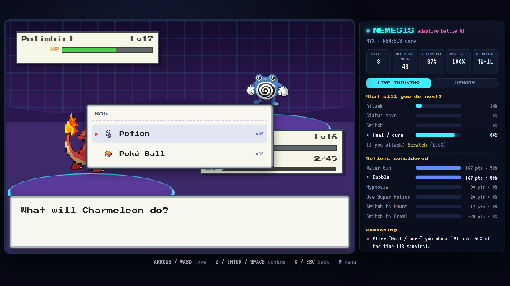
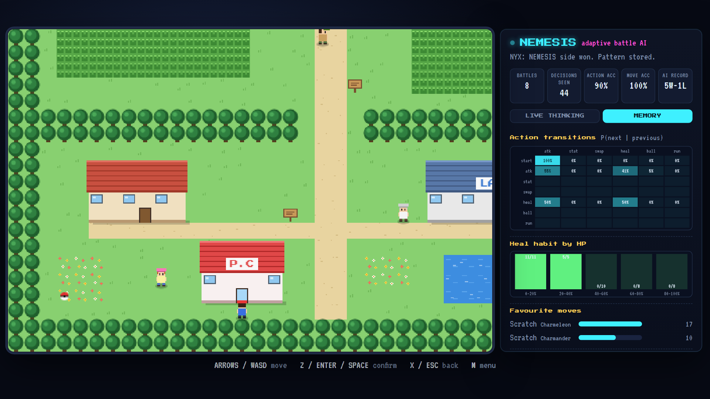

# PokéAPI Nemesis

A 2D Pokémon-style RPG that runs in the browser, with a gym leader AI that learns how you play and uses it against you.

The enemy AI, **NEMESIS**, watches every battle you fight. It predicts your next action, counters your favourite lead, notices when you panic-heal, and only trash talks you when its prediction was right. Nothing it does is scripted: it learns from you, and a side panel shows its thinking live.

Every Pokémon, move, sprite, cry, Pokédex entry, evolution chain and the type chart is loaded live from [PokéAPI](https://pokeapi.co).

Made for the YouTube video **"I Gave My Pokémon Game an AI That Learns to Beat Me"**: [VIDEO LINK]



## Run it

No build step and nothing to install. You need an internet connection for PokéAPI and the sprites.

| Platform | How |
|---|---|
| Windows | Double-click `run.bat` |
| macOS / Linux | `./run.sh` |
| Any OS | `python -m http.server 8000` in this folder |

Then open <http://localhost:8000>.

**Controls:** Arrows / WASD to move · Z / Enter / Space to confirm · X / Esc to go back · M for the menu. Menus also work with the mouse.

## What's in the game

- **A small world:** Rootvale Town, Route 1 with tall grass and trainers who spot you from a distance, and Ascend City with the AI Gym.
- **RPG systems:** EXP and real growth curves, level-up moves, evolution, catching with shake checks, party of 6 and a PC box, bag, shop, money, status conditions, stat stages, critical hits, save and continue.
- **Real battle maths:** the main-series damage formula, same-type bonus, type effectiveness and speed order.
- **Offline fallback:** each resource is cached in `localStorage` after the first download, and a tiny built-in dex keeps the game playable if PokéAPI is down.

## How NEMESIS works

Every trainer shares one memory of the player. Each turn it does four things:

1. **Watch:** records what you did, your HP, the type matchup and the move you used.
2. **Predict:** a smoothed n-gram (Markov) model over your action history, plus trackers for your heal habit, switch habit, favourite moves and favourite lead.
3. **Decide:** scores every option against the prediction only. It never sees your real choice.
4. **Learn:** rewards or punishes the tactic it used based on the HP swing (a small Q-table), and logs whether its guess was right.

How much a trainer trusts that memory depends on its tier: wild Pokémon 0%, trainers 55%, the rival 80%, and the gym leader **NYX** 100%.



The full module-by-module reference, the prediction maths and how to extend the game are in [docs/ARCHITECTURE.md](docs/ARCHITECTURE.md).

To start fresh, wipe NEMESIS's memory from the title screen or the MEMORY tab.

## Project layout

```
index.html          Page shell, loads the scripts in order
css/style.css       Game UI and the NEMESIS panel
js/ai/              PatternLearner (memory + prediction) and EnemyAI (decisions)
js/ui/              Dialogs and menus, battle renderer, the live brain panel
js/world/           Map data and overworld movement
js/*.js             Config, PokéAPI client, battle engine, Pokémon models, sound, input, game state
docs/               Architecture notes and screenshots
```

Plain JavaScript and an HTML canvas, no framework and no game engine.

## Credits and disclaimer

- Data, sprites and cries: [PokéAPI](https://pokeapi.co) and the [PokeAPI/sprites](https://github.com/PokeAPI/sprites) repository, fetched at runtime.
- Fonts: Press Start 2P and VT323 from Google Fonts.
- Sound effects are synthesized in the browser with the Web Audio API.

This is a non-commercial fan project made for learning. Pokémon and all related names, characters and sprites are trademarks of Nintendo, Game Freak, Creatures Inc. and The Pokémon Company. No Pokémon assets are stored in this repository.

The source code is released under the [MIT License](LICENSE).
